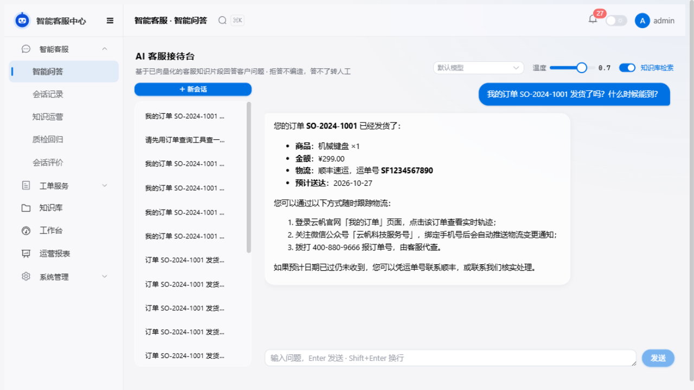
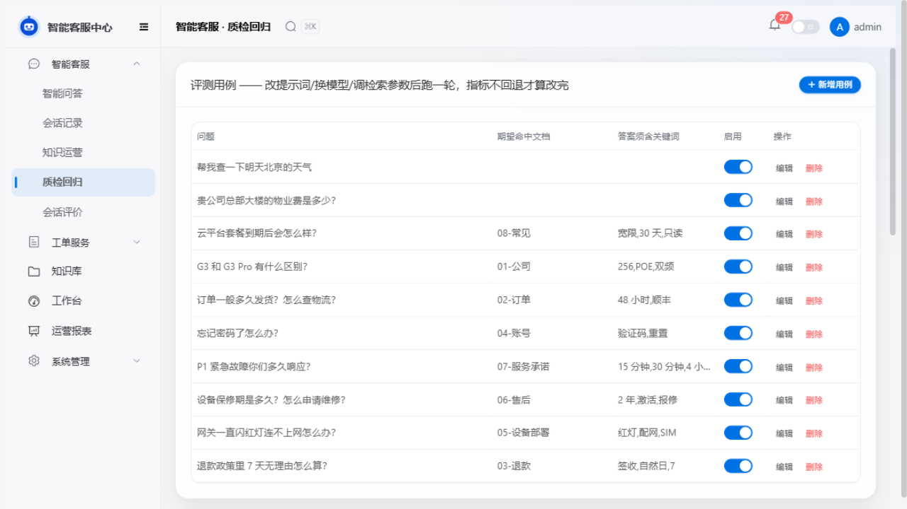

# MCP 客户端接入（Model Context Protocol）

> 定位：把工具层从"编译期 Java 类"升级为"运行时可插拔生态"。
> 外部 MCP server 的工具与本地 `BaseTool` 在 `ToolRegistry` 合并，模型统一 Function Calling 调用，`ToolRouter` 按 `mcp_` 前缀透明分流。

## 架构

```
ReActAgent / PlannerAgent
        │ ToolSpecification 列表（本地 6 个 + MCP 远程 N 个）
        ▼
   ToolRegistry ──合并── McpToolService ── stdio/Streamable HTTP ── 外部 MCP server
        │                                                        （filesystem / mysql / jira / web-search…）
        ▼
   ToolRouter ── mcp_ 前缀 → McpClient.executeTool → ToolResult（统一审计/耗时语义）
```

- **命名规则**：`mcp_<server>_<tool>`（server key 与工具名剔除非法字符，超长截断 64），与本地工具零冲突
- **降级语义**：单个 server 连接失败只记日志跳过，应用与其他 server 不受影响；`agent.mcp.enabled=false` 完全不建立连接
- **审计/指标**：MCP 调用经 `ToolRouter` 包装为 `ToolResult`，`agent_action` 审计与耗时记录自动生效
- **安全**：工具返回内容沿 ReAct 系统提示"不可信数据"规则处理，与 PromptGuard 协同防注入

## 配置（application.yml）

```yaml
agent:
  mcp:
    enabled: ${AGENT_MCP_ENABLED:false}   # 一键开关
    servers:
      - key: demo-order                   # 别名，进工具名前缀
        transport: stdio                  # stdio | http
        command: [node, .../mcp-order-server.mjs]
        # http 远程 server：transport: http + url + headers（鉴权头）
```

改配置后免重启：`POST /api/v1/mcp/refresh` 重连并刷新工具列表；`GET /api/v1/mcp/status` 查看连接与工具清单。

## 演示

**一键演示**：`bash devhub/start-demo.sh`（起中间件 → 清语义缓存 → 后端 MCP 开启 → 前端），然后访问 http://localhost:5173（admin/admin123）问：

> 我的订单 SO-2024-1001 发货了吗？什么时候能到？

实测链路（DeepSeek 主模型）：意图路由命中事务信号 → ReAct → 调用 `mcp_demo-order_query_order`（5ms）→ 回答含 MCP 真实数据（机械键盘/¥299/顺丰 SF1234567890/预计 2026-10-27 送达）：



日志佐证：`ToolRouter 路由工具调用: tool=mcp_demo-order_query_order` + `MCP 工具执行: server=demo-order, elapsed=5ms`。
评测页（质检回归）跑一轮可见 MRR/NDCG 列（实测批次：命中率 100%，MRR=1，NDCG=1）：



## 联调中踩的三个坑（治理设计由此而来）

1. **同域工具冲突**：本地 `query_order`（mock 数据）与 MCP 订单工具同时可见时，模型优先本地且在"未找到"后停止重试 → 引入 `replaces-local-tools` 配置：被 MCP 替代的本地工具不再向模型推广（显式调用仍可执行）。
2. **编排层工具白名单不感知 MCP**：agentic 分支白名单 `AGENT_TOOLS=[query_order, create_ticket]` 不含 MCP 工具，叠加治理隐藏后模型只剩建工单工具 → `listToolSpecificationsForWhitelist`：白名单内被替代的本地工具自动映射其 MCP 同名工具，调用方零改动。
3. **语义缓存实体穿透**：仅订单号不同的两问向量相似度 0.965，语义缓存错误回放旧答案 → `SemanticAnswerCache` 加实体守卫（数字实体集合不同则绕过）。

另：工具描述里的"（演示数据源）"字样会让模型拒绝用它查"真实"订单——MCP 工具描述应写明适用条件与强制性，这是工具描述工程的一部分。

## 测试

- `McpToolServiceTest` / `ToolRouterMcpTest` / `SemanticAnswerCacheEntityTest`：命名规范、禁用态、前缀分流、缓存实体守卫（无需 node）
- `McpDemoServerIT`（`DEVHUB_IT=local` 门控）：真连 node 子进程，覆盖 initialize / tools/list / tools/call / isError 语义

## 设计取舍

- 不引入 `McpToolProvider`（AiServices 专用）：本项目 ReAct 循环自管 `ToolSpecification` 列表，直接用底层 `McpClient` 更贴合现有架构
- server key 保留连字符（函数调用命名合法字符），其余非法字符剔除而非替换，保证路由可逆
- 评测 MRR/NDCG（V34）与 MCP 同批落地：命中率看"是否进 Top-K"，MRR/NDCG 看"排第几"，对齐 RAGAS 检索指标
